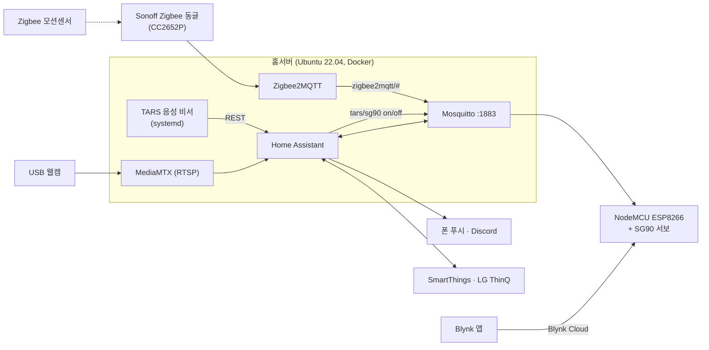

# home-iot — 홈서버 기반 스마트홈 (Home Assistant · MQTT · Zigbee · NodeMCU)

> 상시 가동 Ubuntu 홈서버에 Docker로 Home Assistant·MQTT·Zigbee를 올리고, 음성 비서 TARS와 NodeMCU 스마트전등을 연동한 스마트홈

<!-- TODO(사용자 확인): 대표 사진 docs/images/hero.jpg (스위치에 붙인 서보 전등) -->

| 기간 | 인원 | 역할 | 상태 |
|---|---|---|---|
| 2025.06 ~ 진행 중 | 개인 | 인프라 구축·운영, 펌웨어, 자동화 설계 | 운영 중 |

**Tech** `Docker` `Home Assistant` `Mosquitto (MQTT)` `Zigbee2MQTT` `ESP8266 (NodeMCU)` `Blynk` `systemd` `Ubuntu`

## 1. 개요
- **문제**: 일반 벽 스위치 조명은 원격·음성 제어 불가, 현관 출입을 외출 중에 알 방법 없음
- **목표**: 스위치 교체 없이 서보로 스위치를 눌러 조명을 제어하고, 센서·음성 비서·알림을 한 허브(HA)로 통합
- **결과**: 음성("불 켜줘") → HA → MQTT → 서보 스위치 동작, 현관 모션 감지 시 폰·Discord 알림, 센서·브릿지 장애 자동 알림까지 운영

## 2. 주요 기능
- 스마트전등 — NodeMCU + SG90 서보가 벽 스위치를 물리적으로 누름. MQTT(`tars/sg90`)와 Blynk 앱 두 경로로 제어
- 음성 제어 — [TARS](https://github.com/customer0907/TARS-AI) 음성 비서가 HA REST로 조명·LG 에어컨 제어
- 현관 감지 — Zigbee 모션센서 → Zigbee2MQTT → HA 자동화 → 폰 푸시 + Discord 웹훅
- 장애 알림 — 센서 12시간 무응답, Zigbee 브릿지 오프라인 시 알림
- 자동 복구 — USB 동글·USB 오디오 재열거 시 컨테이너·오디오 설정 자동 복구

## 3. 아키텍처

- 조명 흐름: 음성 → TARS 의도 분류 → `input_boolean.tars_light` → 자동화 → MQTT `tars/sg90` → 서보 160°(on) / 30°(off)
- 상세 구성(컨테이너·통합·자동화·토픽): [docs/INFRA.md](docs/INFRA.md)

## 4. 기술 스택
| 영역 | 기술 | 선택 이유 |
|---|---|---|
| 허브 | Home Assistant (Docker, host network) | 기기·자동화·알림 일원화, 기기 자동 발견 |
| 메시징 | Mosquitto MQTT | 저전력 MCU와 경량 pub/sub |
| Zigbee | Zigbee2MQTT + Sonoff Dongle Plus (펌웨어 직접 플래싱) | 벤더 허브 없이 센서 연동 |
| MCU | ESP8266 NodeMCU, PubSubClient, Blynk | 저가 Wi-Fi MCU, 앱 제어 |
| 운영 | Docker, systemd user service, udev | 자동 재시작, 장치 재열거 대응 |
| 인프라 이력 | AWS EC2 → GCP VM → 홈서버 | 용량·비용·접속 문제로 이전 |

## 5. 내 역할 및 기여
- 개인 프로젝트: 설계·구축·운영 전부
- 클라우드(AWS → GCP)에서 홈서버로 HA 스택 이전, Docker 컨테이너 4종 구성
- NodeMCU 서보 전등 펌웨어 작성 (MQTT + Blynk 이중 제어)
- HA 자동화 5개 설계: 조명 on/off, 현관 감지 알림, 센서·브릿지 오프라인 알림
- Zigbee 코디네이터 펌웨어 플래싱, USB 이탈 대응 컨테이너 구성
- USB 오디오(eMeet) 자동 복구: udev 규칙 + 재적용 서비스 + 에코캔슬 재적재 스크립트

## 6. 트러블슈팅
| 문제 | 원인 | 해결 | 결과 |
|---|---|---|---|
| Zigbee 동글이 빠졌다 다시 꽂히면 z2m 컨테이너 기동 불가 | `devices:`로 고정한 장치 노드가 사라지면 컨테이너 생성 실패 | `/dev` 전체 마운트 + `device_cgroup_rules: c 188:* rmw`, `Z2M_WATCHDOG` 재시도 | 재열거 후에도 컨테이너 유지·자동 재연결 |
| 센서 배터리 문제로 알림이 조용히 끊김 (2026-09-04) | 센서 오프라인을 감지하는 수단 없음 | availability(passive 12h) 기반 오프라인 알림 자동화 | 무음 장애 재발 시 즉시 인지 |
| USB 스피커폰 재열거 후 오디오 실종 | autosuspend, 죽은 장치에 물린 echo-cancel 모듈 잔존 | udev로 autosuspend 금지·재적용 서비스 트리거, 좀비 모듈 제거 후 재적재 | 재연결 시 자동 복구 |
| 클라우드 VM SSH 접속 불가 | 인스턴스 재시작 시 유동 IP 변경 → MCU의 MQTT 주소 불일치 | 홈서버로 이전, LAN 고정 주소 | 운영 안정화 |

## 7. 성과
- 상시 운영 컨테이너 4종 (Home Assistant, Mosquitto, Zigbee2MQTT, MediaMTX)
- HA 자동화 5개, HA 통합 13종(MQTT, SmartThings, LG ThinQ, 모바일 앱 등)
- TODO(사용자 확인): 운영 기간·가동률 등 정량 수치

## 8. 실행 방법
```bash
git clone https://github.com/customer0907/home-iot.git
cd home-iot/infra/ha-stack && docker-compose up -d          # Home Assistant + Mosquitto
cd ../zigbee2mqtt && docker-compose up -d                   # 동글 경로를 configuration.yaml 에 맞게 수정
```
- 펌웨어: `firmware/smart_light/secrets.h.example` → `secrets.h` 복사 후 값 입력 → Arduino IDE로 NodeMCU 업로드
- 필요 라이브러리: `Blynk`, `PubSubClient`, `Servo` (ESP8266 보드 패키지)

## 9. 디렉터리 구조
```
home-iot/
├── docs/INFRA.md              # 서버·컨테이너·HA 통합·자동화·MQTT 토픽 상세
├── firmware/smart_light/      # NodeMCU 서보 전등 (secrets.h 는 Git 제외)
└── infra/
    ├── ha-stack/              # HA + Mosquitto compose, configuration·automations
    ├── zigbee2mqtt/           # z2m compose, 설정 (비밀값 제거)
    ├── mediamtx/
    ├── emeet-fix/             # USB 오디오 자동 복구 (udev, 스크립트)
    ├── systemd-user/          # TARS·알람·오디오 재적용 서비스
    └── docker-watchdog/       # 컨테이너 감시·장애 기록 스크립트
```

## 10. 회고
- 잘한 점: 장애를 겪을 때마다 "감지 → 알림 → 자동 복구"를 구성에 반영
- 아쉬운 점: MQTT 익명 접속·`latest` 태그·compose 분산 → 인증·태그 고정·compose 통합 예정
