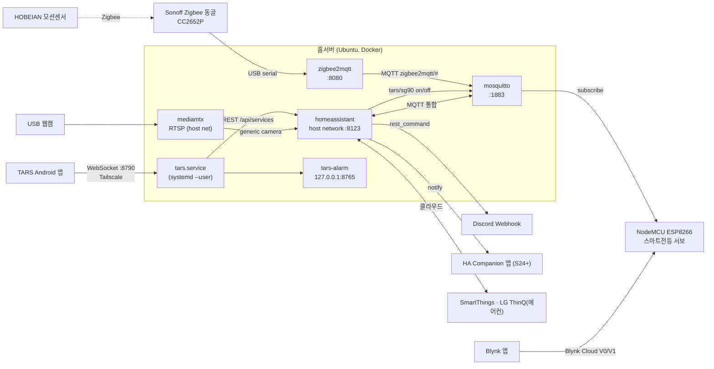

# 홈서버 인프라 기록 (Home Assistant · MQTT · Zigbee · TARS)

> 2026-11-09 기준 실제 운영 중인 서버를 조사해 정리한 문서입니다.
> 비밀값(토큰·비밀번호·웹훅 URL)은 모두 `***REDACTED***` 처리했고, 원본은 서버에만 있습니다.
> 설정 파일 사본: [`infra/`](../infra/)

## 1. 호스트

| 항목 | 값 |
|---|---|
| 기기 | Samsung 노트북 550XBE/350XBE (상시 가동) |
| OS | Ubuntu 22.04.5 LTS, kernel 6.8 |
| 메모리 | 7.6 GiB |
| 런타임 | Docker 29.1.3 (`docker compose` 플러그인 없음 → `docker-compose` v1 또는 `docker run`) |
| 호스트 서비스 | nginx(리버스 프록시), Samba, Tailscale, smartmontools |
| cron | DuckDNS 갱신(5분), 개인 스크립트들 |
| USB | Sonoff Zigbee 3.0 USB Dongle Plus(CP210x), eMeet OfficeCore M0 Plus, USB 웹캠 |

### 이전 이력
- **AWS EC2** → 디스크 용량 부족 → **GCP VM**(MQTT로 HA 연동) → SSH 접속 불가·유동 IP 문제 → **현재 집 서버로 이전**
- 흔적: HA 스택 compose 경로가 `~/mnt/ha$HOME/` (이전 서버 홈 디렉터리를 통째로 옮긴 구조)

## 2. 전체 구조



## 3. 컨테이너

| 컨테이너 | 이미지 | 네트워크 | 포트 | 볼륨/장치 | compose 위치 |
|---|---|---|---|---|---|
| `homeassistant` | `ghcr.io/home-assistant/home-assistant:stable` (2026.5.4) | host | 8123 | `./homeassistant:/config` | `~/mnt/ha$HOME/docker-compose.yml` |
| `mosquitto` | `eclipse-mosquitto:latest` | `<user>_default` | 1883 | config/data/log | 위와 동일 |
| `zigbee2mqtt` | `koenkk/zigbee2mqtt` | bridge | 8080 (프런트엔드) | `./data`, `/dev` 전체, `/run/udev` | `~/zigbee2mqtt/docker-compose.yaml` |
| `mediamtx` | `bluenviron/mediamtx:latest` | host | RTSP 8554 | - | `~/mediamtx/docker-compose.yml` |

- 모든 컨테이너 재시작 정책은 실제로 `always`입니다(compose 파일에는 일부 `unless-stopped`로 적혀 있어 서로 다름).
- zigbee2mqtt는 bridge 네트워크에 있어서 **`mqtt://172.17.0.1:1883`(docker0 게이트웨이)** 로 호스트에 공개된 mosquitto에 붙습니다.
- `~/zigbee2mqtt/mosquitto/`는 비어 있는 예전 디렉터리입니다(현재 브로커는 HA 스택 쪽 mosquitto).

## 4. Home Assistant 구성

### 통합(Integrations)
| 도메인 | 용도 |
|---|---|
| `mqtt` (127.0.0.1) | mosquitto 연결, Zigbee2MQTT 디바이스 자동 발견 |
| `smartthings` | 삼성 SmartThings 기기 |
| `lg_thinq` | LG 에어컨 (`RAC_0C0001_WW`) → TARS 음성 제어 대상 |
| `generic` (127_0_0_1) | mediamtx RTSP 웹캠 |
| `go2rtc` | 카메라 스트림 변환 |
| `mobile_app` | Galaxy S24+ (HA 앱에서 "삼성노트북"으로 등록됨) → 푸시 알림 |
| `met`, `sun`, `google_translate`, `radio_browser`, `shopping_list`, `backup`, `cloud` | 기본 |

### configuration.yaml 핵심 ([사본](../infra/ha-stack/homeassistant/configuration.yaml))
- `input_boolean.tars_light`: 전등 상태를 담는 가상 스위치
- `light.tars_light` (template light "TARS 조명"): 위 boolean을 조명 엔티티로 노출해 음성 비서·대시보드에서 일반 조명처럼 제어
- `rest_command.discord_notify`: Discord 웹훅으로 알림 (`!secret discord_webhook_url`)

### 자동화 ([사본](../infra/ha-stack/homeassistant/automations.yaml))
| ID | 트리거 | 동작 |
|---|---|---|
| `tars_turn_on_light` | `input_boolean.tars_light` → on | MQTT publish `tars/sg90` = `on` |
| `tars_turn_off_light` | `input_boolean.tars_light` → off | MQTT publish `tars/sg90` = `off` |
| `zigbee_door_mobile_app` | 현관 모션센서 occupancy off→on | 폰 푸시 + Discord |
| `zigbee_sensor_offline_alert` | `zigbee2mqtt/<센서>/availability` = offline | "센서 12시간 무응답" 알림 (2026-09-04 무음 사고 재발 방지) |
| `zigbee_bridge_offline_alert` | `zigbee2mqtt/bridge/state` = offline (10분 쿨다운) | Discord 알림 (USB 재열거 사고 대비) |

## 5. MQTT (mosquitto)
- `listener 1883`, `allow_anonymous true` → **LAN 전용 전제.** 외부 노출 시 계정·ACL 필요(개선 과제).
- 토픽

| 토픽 | 발행 | 구독 | 내용 |
|---|---|---|---|
| `tars/sg90` | HA 자동화 | NodeMCU 스마트전등 | `on`(서보 160°) / `off`(서보 30°) |
| `zigbee2mqtt/#` | Zigbee2MQTT | HA | 센서 상태·availability |
| `homeassistant/#` | Zigbee2MQTT | HA | MQTT Discovery |

## 6. Zigbee2MQTT ([사본](../infra/zigbee2mqtt/))
- 코디네이터: Sonoff Zigbee 3.0 USB Dongle **Plus**(CC2652P), `adapter: zstack`, 포트는 `/dev/serial/by-id/...`로 고정
- 펌웨어: `CC1352P2_CC2652P_launchpad_coordinator_20250321` 을 `cc2538-bsl`로 직접 플래싱
- 무선: 채널 11, `transmit_power: 20`
- 기기: HOBEIAN 모션센서 2대 (현관 = `HA-DISCORD`)
- availability: active 10분 / passive 720분(12시간)
- 안정화 조치 (USB 동글 빠짐 사고 대응)
  - `devices:` 고정 대신 **`/dev` 전체 마운트 + `device_cgroup_rules: c 188:* rmw`** → 동글이 재열거돼도 컨테이너가 죽지 않음
  - `Z2M_WATCHDOG=default` → 어댑터 끊김 시 2s→1m→5m→…→60m 간격 자동 재시도
  - 채널 변경 시도 전후 백업: `z2m-backup-20260915-*.tar.gz`, `configuration.yaml.bak-*`

## 7. 스마트전등 연동 (NodeMCU)
```
"불 켜줘"(TARS 음성) ─▶ TARS module_homeassistant (_detect_light_intent)
   ─▶ HA REST POST /api/services/input_boolean/turn_on
   ─▶ automation tars_turn_on_light ─▶ MQTT tars/sg90 "on"
   ─▶ mosquitto ─▶ NodeMCU(ESP8266) ─▶ SG90 서보 160° → 벽 스위치 물리적으로 누름
(별도 경로) Blynk 앱 버튼 V0/V1 ─▶ Blynk Cloud ─▶ NodeMCU ─▶ 서보 30°/150°
```
- 펌웨어: [`firmware/smart_light/`](../firmware/smart_light/)

## 8. TARS 서버 측 (systemd --user)
| 유닛 | 역할 |
|---|---|
| `tars.service` | `~/TARS-AI/src/app.py` 음성 비서. `ExecStartPre`로 오디오 세팅, `Restart=always`, 재시작 제한 해제 |
| `tars-alarm.service` | 독립 알람 데몬(표준 라이브러리만 사용), `127.0.0.1:8765` HTTP API. TARS 본체가 죽어도 알람은 울림 |
| `emeet-reapply.service` | eMeet USB 재열거 시 udev가 트리거 → 오디오 세팅 재적용 |

- 음성: Gemini Live(`gemini-3.1-flash-live-preview`) full-duplex, 에코 꼬리 600ms 처리
- 폰 브리지: TARS Android 앱이 마이크·스피커 역할만 하고, 세션은 서버에서 실행 (WebSocket, Tailscale, 포트 8790, 토큰 인증)
- HA 연동: `[HOME_ASSISTANT] ha_skip_llm=true` → 조명/에어컨 의도는 LLM을 거치지 않고 바로 HA REST 호출
- 에어컨: `climate.turn_on/off`, `set_temperature`, `set_hvac_mode`, `set_fan_mode` (LG ThinQ)

### eMeet OfficeCore M0 Plus 안정화 ([`infra/emeet-fix/`](../infra/emeet-fix/))
- 문제: USB 스피커폰이 절전·재열거되면 PulseAudio 소스/싱크가 사라지고, echo-cancel 모듈이 죽은 장치에 물린 채 남음
- 조치
  - udev 규칙: eMeet(`328f:0109`)과 상위 허브(`05e3:0610`) **USB autosuspend 금지**, 재열거 시 `emeet-reapply.service` 실행
  - `tars-audio-setup.sh`: 싱크·소스 **둘 다** 뜰 때까지 대기 → 좀비 `module-echo-cancel` 제거 → WebRTC AEC 재적재
  - `emeet-usbreset.sh`: `usbreset 328f:0109`로 USB 스택 하드 리셋 (sudoers NOPASSWD 한정)
  - 진단: `emeet-check.sh`, `mic-live-test.sh` (내장 마이크와 대조해 발화 구간 비교)

## 9. 운영·장애 대응
- `docker-watchdog.sh`: 꺼진 컨테이너 감지 → 종료 코드·로그로 원인 추정 → 재기동 → `incidents.md` 기록. **현재 cron 미등록**(2026-08-24 이후 기록 없음)
- HA 자동화로 센서/브릿지 오프라인 알림 (§4)
- 백업: `ha_full_backup.tar.gz`, z2m 백업 tar 3개

## 10. 개선 과제
- [ ] mosquitto 인증·ACL 적용 (`allow_anonymous false`)
- [ ] compose 파일 위치 통합(`~/mnt/ha/...`, `~/zigbee2mqtt`, `~/mediamtx` → 한 곳) 및 재시작 정책 통일
- [ ] 이미지 태그 고정(`latest`/`stable` → 버전)
- [ ] docker-watchdog cron 재등록 여부 결정
- [ ] TARS-AI 서버 작업본의 미커밋 변경 정리 후 push
